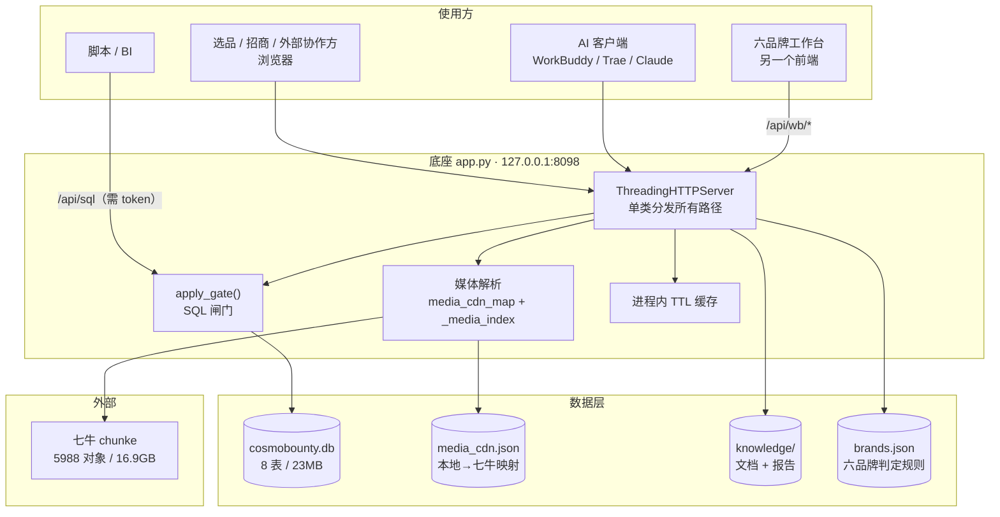
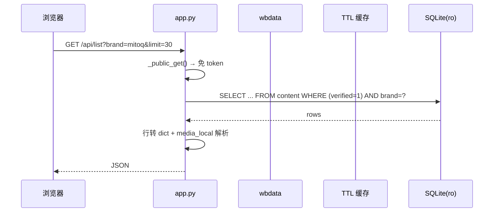
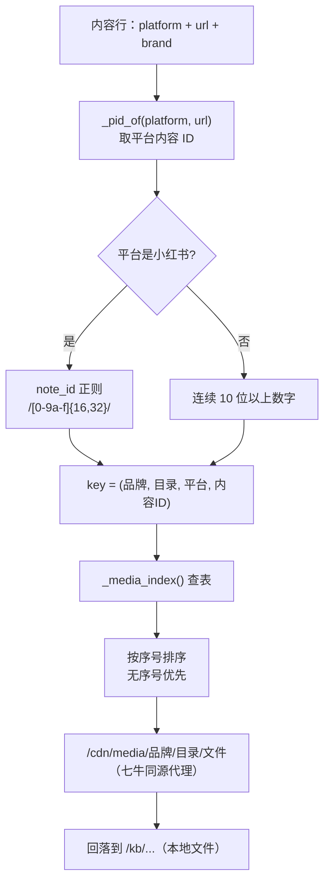
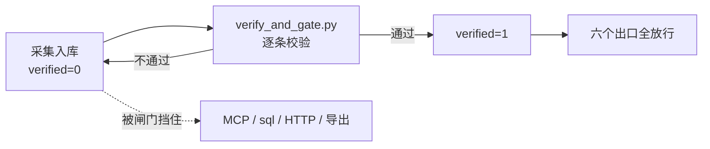

# 逆龄观察 · 技术架构

> **这份文档的位置**：底座（`app.py`）是整个平台的唯一数据出口，逆龄观察是面向它的浏览层。
> 这里讲清"数据怎么从平台进到库里、又怎么被安全地取出去"，以及每一处刻意的限制。
>
> 专题细节： [01 拓扑](docs/01-topology.md) · [04 逆龄观察](docs/04-niling.md) ·
> [05 采集流水线](docs/05-pipeline.md) · [06 媒体](docs/06-media.md) ·
> [07 部署](docs/07-deploy.md) · [08 数据模型](docs/08-data-model.md)
>
> 代码基线：`app.py` 1593 行 · `wbdata.py` 518 行 · `index.html` 755 行 · `crawler/` 95 个脚本。
> 数字取自 2026-10-29 的 `main` 分支。

---

## 目录

- [1. 定位与边界](#1-定位与边界)
- [2. 系统上下文](#2-系统上下文)
- [3. 进程与运行时](#3-进程与运行时)
- [4. 模块划分](#4-模块划分)
- [5. 关键链路](#5-关键链路)
- [6. 数据层](#6-数据层)
- [7. 媒体层](#7-媒体层)
- [8. 采集流水线](#8-采集流水线)
- [9. 缓存与性能](#9-缓存与性能)
- [10. 安全边界](#10-安全边界)
- [11. 失败模式](#11-失败模式)
- [12. 扩展点](#12-扩展点)
- [13. 技术债](#13-技术债)

---

## 1. 定位与边界

**一句话**：把六个品牌的公开内容变成可查、可核、可横评的数据，并用一个只读服务把它安全地发出去。

| 做什么 | 落到哪 |
|---|---|
| 浏览/检索 5996 条内容，每条能回原文 | `index.html` + `/api/list` `/api/item` |
| 六品牌同口径横评 | `/api/compare` + `wbdata.bundle()` |
| 知识库（品牌档案 / 产品事实 / 报告） | `/api/kb_*` |
| 导出（宽表 / 打包 / 归档 / 达人表） | `/api/export` `/api/raw_export` `/api/xhs_archive` |
| 给 AI 客户端的数据接口 | `POST /mcp` + `mcp/cosmobounty_server.py` |
| 给工作台的实时数据层 | `/api/wb/*` |
| 采集、清洗、富化、入库 | `crawler/pipeline.py` 四段式 |

| 明确不做 | 原因 |
|---|---|
| **不写业务库** | SQLite 用 `mode=ro` 打开，从连接层就禁止写。写库只发生在 `crawler/` 的 ingest 段 |
| 不做用户系统 | 只有"有 token / 没 token"两态。这是给外部协作者看数据的服务，不是多用户产品 |
| 不做前端构建 | `index.html` 是服务端直接吐的单文件，无打包步骤 |
| 不做实时采集 | 采集是离线批处理。页面上看到的永远是"上一轮采集的快照" |
| 不做情感分析 | `sentiment` 整列为空 —— 没有可信模型，宁可空着也不编 |

---

## 2. 系统上下文



**注意 `mode=ro` 的位置**：只读不是靠"代码里不写 INSERT"来保证的，而是连接串层面就拒绝写。这比任何代码审查都可靠。

---

## 3. 进程与运行时

### 3.1 单进程 · 标准库

| 项 | 值 |
|---|---|
| 运行时 | Python 3.9+，**零第三方依赖** |
| 服务器 | `http.server.ThreadingHTTPServer`（每请求一线程） |
| 默认端口 | 8080；部署固定 8098（8080 被 nginx 占） |
| 绑定 | 部署时 `127.0.0.1`，由星河网关反代 |
| 请求分发 | **一个 `BaseHTTPRequestHandler` 子类**，`do_GET/do_POST` 里按路径前缀分发 |

### 3.2 为什么线程模型是"每请求一线程"

数据是只读的，唯一的共享状态是 TTL 缓存（加 `threading.Lock`）。这种场景下线程池带来的复杂度（队列、拒绝策略、超时传播）换不来什么 —— 读多写零，线程间没有写冲突。

### 3.3 只读连接的两种形态

```python
# wbdata.py
conn = sqlite3.connect("file:%s?mode=ro" % DB, uri=True, timeout=10)
```

`mode=ro` 让 SQLite 在打开时就拒绝任何写操作，即使代码写错也不会污染库。`timeout=10` 是等锁超时（采集进程正在写库时会短暂持锁）。

### 3.4 路径探测（拆仓后必须自适应）

```python
def _detect_root(here):
    # 部署布局 /data/apps/cosmobounty/service/app.py → 根在上一层
    # 仓库布局 <repo>/app.py                       → 根就是自己
    for d in ("crawler", "workbench"):
        if os.path.isdir(os.path.join(here, d)):
            return here
    return os.path.dirname(here)
```

**判据不能用 `data/`**：部署时 `service/data/` 确实存在（上传脚本会写两份），用它判断会把 ROOT 定到 `service/`，于是 `db/`、`knowledge/` 全部找错。

---

## 4. 模块划分

### 4.1 `app.py`（1593 行）

| 行区间 | 分区 | 职责 |
|---|---|---|
| 1–143 | 常量 + 路径探测 | ROOT / DB / KB / CDN_BASE / 平台与品牌常量 |
| 144–211 | db helpers | 连接、`verified=1` 基座查询、行转 dict |
| 212–473 | knowledge helpers | 知识库索引、文档读取、知识库媒体 |
| 474–1030 | **tools** | MCP 工具定义 + 实现（**MCP 与 REST 共用同一批函数**） |
| 1031–1593 | http | 请求分发、鉴权、静态、`/cdn` 代理、各端点 |

「tools 与 REST 共用」是这个文件最重要的结构决定：`content_stats` 这个能力只有一份实现，MCP 调用和 `GET /api/stats` 都走它。所以不会出现"AI 看到 3034 条、页面看到 5996 条"这种口径分裂。

### 4.2 `wbdata.py`（518 行）

工作台的实时数据层。核心函数：

| 函数 | 作用 | 缓存 TTL |
|---|---|---|
| `bundle()` | 全局总览（`data.js`） | 120s |
| `list_rows(slug)` | 单品牌内容清单 | 120s |
| `detail_map(slug)` | 单品牌深度数据 | 300s |
| `pending_map()` | 待核队列 | 120s |
| `media_map()` | 媒体映射 | 300s |
| `local_media_index()` | 媒体落地索引 | 600s |
| `media_stat()` | 各品牌媒体/视频/正文统计 | — |

**输出格式与旧静态文件逐字节兼容**（`var LIST_x = {...}` / `window.MEDIA_CDN = {...}`）。这是刻意的：工作台从"构建期烤快照"改成"按请求现算"时，前端一行没改。

### 4.3 目录职责

```
app.py            唯一数据出口：浏览页 + JSON API + MCP
wbdata.py         工作台实时数据层
index.html        逆龄观察浏览页（7 个 tab，前端取数）
crawler/          采集与清洗（95 脚本，主线 pipeline.py）
  pipeline.py       四段式入口：fetch → clean → process → ingest
  verify_and_gate.py    校验并打标 verified
  check_data_boundary.py 边界守卫（15+ 项）
  upload_qiniu.py   媒体上传（增量幂等）
mcp/              MCP 服务端 + 配置片段
skills/           技能包 cosmobounty-insight
config/           brands.json（六品牌判定规则）
db/schema.sql     8 张表结构（库本身不进仓库）
deploy/           niling.service + install.sh
scripts/          部署 / 证书 / 打包 / 修数据
workbench/        六品牌工作台前端（另一个项目视角，同一套数据）
```

---

## 5. 关键链路

### 5.1 一次列表请求



`media_local` 是每次都要算的：`local_media(platform, url, brand, media, "video")` 走 `_media_index()`（有 600s 缓存），把"这条内容的视频在哪"解析成 `/cdn/...`。

### 5.2 媒体解析（最容易错的一环）



三个必须记住的细节：

| 细节 | 为什么 |
|---|---|
| 小红书走 `note_id` 正则，不用"连续数字" | note_id 是 24 位十六进制，夹着 a–f，数字正则会抓错 |
| 后缀和序号**不靠猜**，按文件名索引解析 | 老实现只试 `.jpg/.png/.webp`，而 LAIFE/MitoQ/W+ 两千多张封面是 `.jpeg`，全部被判"未存" |
| 多图笔记按 `idx` 排序，无序号优先 | 老实现只试无序号那个文件，第 2 张起全判缺失 |

### 5.3 SQL 闸门（唯一的高危出口）

`POST /api/sql` 和 MCP 的 `sql_query` 都允许自由 SELECT。这是最大的泄漏口：任何一个接口都可以过滤 `verified=1`，但用户自己写的 SQL 不会。

`apply_gate()` 的做法是**改写 SQL 结构**，不是校验：

```sql
-- 用户输入
SELECT brand, COUNT(*) FROM content GROUP BY 1

-- 实际执行
WITH _gc AS (SELECT * FROM content WHERE verified=1)
SELECT brand, COUNT(*) FROM _gc GROUP BY 1
```

三个受控表各自有 CTE：`content → _gc`、`xhs_note → _gx`、`comment → _gm`（`_gm` 还要 `content_id IN (SELECT id FROM content WHERE verified=1)`，避免"内容未校验但评论能查"）。

已带 `WITH` 的 SQL 会被插进 CTE 列表而不是再套一层，靠括号深度扫描找插入点。

> 这是唯一需要"理解 SQL 结构"的地方，也是最容易出漏洞的地方。已知边界见 [13. 技术债](#13-技术债)。

### 5.4 导出

| 端点 | 产物 | 特点 |
|---|---|---|
| `/api/export` | CSV 宽表 | 每品牌一行一条，直接进 Excel |
| `/api/raw_export` | 原始 JSON | 保留全部字段，给脚本用 |
| `/api/xhs_archive` | 小红书归档页 | 每篇笔记一页，可离线打开 |
| `/api/kb_export` | 知识库打包 | 含媒体清单 |

导出**全部走同一套 `verified=1` 查询**，不存在"导出时忘了过滤"的可能 —— 因为它们不各写 SQL，而是共用 db helpers。

### 5.5 MCP

`POST /mcp` 实现 MCP 的 JSON-RPC（`initialize` / `tools/list` / `tools/call`）。9 个工具：

`content_stats` · `search_content` · `get_content` · `brand_compare` · `top_content` ·
`search_comments` · `pending_content` · `kb_docs` · `kb_doc` · `sql_query`

每个工具的 `description` 里写了**什么时候该用它**，而不只是参数说明 —— 这是给模型看的，会直接影响它选哪个工具。

---

## 6. 数据层

### 6.1 八张表

| 表 | 行数 | 作用 |
|---|---|---|
| `content` | 5996 | 全平台内容主表（brand / platform / content_type / verified） |
| `xhs_note` | 4145 | 小红书笔记档案，带证据三级（strong / weak / tag） |
| `comment` | 1898 | 评论，外键 `content_id`，覆盖 252 条内容 |
| `media_text` | 1715 | 图片 OCR + 视频 ASR 文本，让无正文笔记可参与判定 |
| `creator` | 915 | 达人（主键 `platform + creator_id`） |
| `crawl_log` | 334 | 采集日志（ok / empty / blocked） |
| `fetch_skip` | 78 | 补采跳过记录 |
| `daily_metric` | **0** | 建表未跑数 → **日度趋势没有数据源** |

最后一行是必须说清楚的：`daily_metric` 空表意味着任何"近期趋势"类结论都没有数据支撑。

### 6.2 `verified` 是唯一准入



| 出口 | 加闸方式 |
|---|---|
| MCP 工具 | 查询里硬编码 `verified=1` |
| `POST /api/sql` | `apply_gate()` CTE 改写 |
| HTTP API | 基座查询过滤 |
| 导出 / CSV / 归档页 | 共用 db helpers |

> 「完整」和「正确」不是一回事：覆盖率体检（`health_check`）看缺多少，校验（`verify_xhs_data`）看对不对，边界守卫（`check_data_boundary`）看漏没漏。三件事缺一不可。

### 6.3 五条不变量

1. **一个品牌一条内容只算一次** —— 去重键 `text_hash`，重跑幂等
2. **蹭词位不进品牌横评** —— 搜索词命中但正文没提品牌，单独计数
3. **品类场景词独立轨道** —— 熬夜/精力/抗疲劳这类，有分析价值但不能给某品牌凑声量
4. **缺时间不删，标记待补** —— 留给 process 段补，不在 clean 段误杀
5. **媒体证据参与判定** —— 无正文的笔记不能因"没正文"直接排除

---

## 7. 媒体层

### 7.1 双空间

| 空间 | 区域 | 域名 | 内容 | 访问 |
|---|---|---|---|---|
| `chunke` | 华南 z2 | `tni044vir.hn-bkt.clouddn.com`（**只 HTTP**） | 公开素材 5988 对象 / 16.9GB | 直接 URL |
| `sr-private` | 华东 z0 | `sr.pianai.love`（HTTPS） | 星河客户私有素材 | **必须签名** |

### 7.2 为什么走 `/cdn/` 同源代理而不直连

| 直连七牛 | 走 `/cdn/` |
|---|---|
| HTTPS 页面引 HTTP 图片 → 混合内容告警 | 同源，无告警 |
| 测试域名只支持 HTTP | 代理层可以决定协议 |
| 源站带 `Range` 支持要额外处理 | `_cdn_proxy()` 已实现 Range，视频可拖动 |
| 暴露七牛域名 | 只暴露自家域名 |

代价：本机带宽被占。所以有 `Cache-Control: public, max-age=86400` 让浏览器和 CDN 缓存住。

### 7.3 媒体映射的三级查找

```python
cands = [
    os.environ.get("COSMOBOUNTY_CDN_MAP"),          # 1. 环境变量（systemd 里设）
    os.path.join(ROOT, "data", "media_cdn.json"),    # 2. 正确位置
    os.path.join(HERE, "data", "media_cdn.json"),    # 3. 旧布局，兼容
]
```

**读不到表必须打告警，不能静默**。曾经这里写死 `HERE/data/`，而部署脚本只往 `ROOT/data/` 推 —— 服务器上那个位置什么都没有，结果 5996 条内容的封面和视频**全部**被判"未落地"，页面上写着"视频文件未落地本站"，可七牛上明明躺着 2183 个视频。

本地测不出来，因为 `upload_qiniu.py` 会写两份（`data/` 和 `service/data/`），开发机的副本掩盖了问题。

---

## 8. 采集流水线

```
① fetch   → data/raw/<plat>/<date>.jsonl       原始响应，只落盘，不做业务判断
② clean   → data/clean/<plat>/<date>.jsonl     每条带 accept/reject + reason
③ process → data/enriched/<plat>/<date>.jsonl  下载媒体 + OCR/ASR
④ ingest  → db/cosmobounty.db                  唯一写库的地方，幂等
```

```bash
python3 crawler/pipeline.py --platform baidu --all     # 全链路
python3 crawler/pipeline.py --stages clean,ingest      # 只重跑某段
python3 crawler/pipeline.py --status                   # 状态 + 三层产物统计
python3 crawler/pipeline.py --dry-run                  # 只质检不入库
```

**为什么不是"边抓边入库"**：旧链路脏数据先落库、靠闸门事后拦。真出问题时看不出错在哪一段，只能全量重跑。现在每段有可验收的中间产物，任何一段能单独重跑、单独定位。

**业务判断全部集中在 clean 段**，且每条必须留 `reason` —— 这是"可复核"的前提。

---

## 9. 缓存与性能

### 9.1 进程内 TTL 缓存

```python
def _cached(key, ttl, fn):
    # 命中且未过期 → 直接返回；否则算完存起来
```

| 键 | TTL | 理由 |
|---|---|---|
| `media_idx` | 600s | 全量扫映射表最贵，媒体文件几乎不变 |
| `media_map` | 300s | 同上 |
| `detail:<slug>` | 300s | 聚合计算重，单品牌数据 5 分钟不变 |
| `bundle` / `list:<slug>` / `pending` | 120s | 用户感知"刷新就该变"，2 分钟足够 |

**缓存没有主动失效**，靠 TTL 自然过期。采集入库后最多等 2 分钟页面才更新 —— 这个延迟是接受的，因为它换来了「不用管缓存一致性」。

### 9.2 实测

| 指标 | 值 |
|---|---|
| 库大小 | 23.1 MB / 15085 行 |
| `/api/list?limit=1` 响应 | 约 180 KB（含完整字段） |
| `/api/wb/list.js?brand=mitoq` | 约 230 KB |
| `/api/item` 单条 | 数 KB |
| 冷启动到可服务 | < 1s |

---

## 10. 安全边界

### 10.1 三层鉴权

| 层 | 判定 | 说明 |
|---|---|---|
| 公开 GET | `PUBLIC_GET` 白名单 + `/api/wb/*` 前缀 | 浏览即读，不需要密钥 |
| 需要 token | 其余 GET/POST，`X-API-Key` 头或 `?k=` | `POST /api/sql`、`GET /api/pending`、`POST /mcp` |
| 网关层 | 星河反代时只放行 `CB_API_PATHS` | 白名单而非黑名单 |

`/api/pending` **故意不在** `PUBLIC_GET` 里：它返回 `verified=0` 的待核内容，属于未校验数据。

### 10.2 token 的来源

- 优先 `CB_TOKEN` 环境变量
- 其次 `data/token.txt`（首次启动自动生成，权限 0600）
- `sharecode` 必须显式配置，没有默认值

早期版本有硬编码默认 token，已移除 —— 默认值等于没有鉴权。

---

## 11. 失败模式

| 失败 | 表现 | 系统行为 | 用户看到 |
|---|---|---|---|
| 库文件缺失 | `sqlite3.connect` 抛错 | 启动即失败 | 服务起不来（不静默重建空库） |
| 库被采集进程锁住 | `database is locked` | `timeout=10` 等待 | 慢一点，不报错 |
| 媒体映射表缺失 | 空表 | **打告警**，媒体全部判"未落地" | 明确提示"未落地"，不是白屏 |
| 七牛不可达 | `/cdn/` 代理 502 | 返回 502 + 纯文本 | 图片裂开，页面其余正常 |
| 知识库文档不存在 | 404 | `{"error":"..."}` | 提示不存在 |
| SQL 语法错 | SQLite 抛异常 | 400 + 错误信息 | 明确报错 |
| SQL 含写操作 | `mode=ro` 拒绝 | 400 | "attempt to write a readonly database" |
| 端口被占 | 绑定失败 | 启动即失败 | 明确报错（不静默换端口） |

---

## 12. 扩展点

### 加一个平台

1. `PLATFORMS` 字典加一项（`app.py` 顶部）
2. `crawler/` 加对应的 fetch/clean 适配
3. `workbench/shared.js` 的 `PLAT_META` 加平台属性（社媒看互动 / 媒体看收录）
4. `_pid_of()` 如果新平台的 ID 规则特殊，加一个分支

### 加一个品牌

只改 `config/brands.json`：品牌名、别名、搜索词、竞品关系、数据归属。**不改代码** —— 六家的判定规则必须由同一份配置驱动，写进代码就难免分叉。

### 加一个 API

`app.py` 的 `do_GET`/`do_POST` 里加一条分发。注意：
- 如果返回内容，**必须**用带 `verified=1` 的基座查询
- 如果放在 `/api/wb/` 下，记得加进工作台的兼容格式

### 加一个 MCP 工具

`TOOLS` 数组加 schema，再在工具实现区加一个分支。实现**必须复用 db helpers**，不要自己写 SQL —— 否则闸门管不到你。

---

## 13. 技术债

| 债 | 现状 | 后果 | 何时必须还 |
|---|---|---|---|
| `apply_gate()` 靠正则改写 SQL | 只认 `FROM content` / `JOIN content` 这类写法 | `FROM main.content`、`FROM "content"`、子查询别名等写法可能绕过 | 一旦对外提供 SQL 接口给不受信的人 |
| 单文件 `app.py` 1593 行 | 分发 + 工具 + 静态 + 代理都在一起 | 改动半径大 | 继续加接口 |
| 缓存无主动失效 | 靠 TTL | 入库后最多 2 分钟才更新 | 需要"发布即可见"时 |
| 媒体索引全量扫 | 5988 条映射每次启动重建 | 冷启动慢，内存占用随媒体数线性增长 | 媒体数过万 |
| `daily_metric` 空表 | 建表未跑数 | **无日度趋势数据** | 要回答"最近涨没涨" |
| `sentiment` 空列 | 无判断模型 | **不能讲正负面占比** | 有可信模型时 |
| `publish_time` 空 38% | 采集时部分平台拿不到 | "近期声量"结论要打折 | 补齐或明确标注 |
| 无并发压测 | 无数据 | 不知道 ThreadingHTTPServer 的拐点 | 给更多人用之前 |
| crawler 95 个脚本 | 历史迭代堆积，主线是 `pipeline.py` | 新人不知道哪个是活的 | 做一次清理归档 |

---

## 附：和另外两个项目的关系

| 产品 | 在哪个仓库 | 和数据的关系 |
|---|---|---|
| **逆龄观察** | 本仓库（`app.py` + `index.html`） | **就是**这套数据的浏览层 |
| **六品牌内容工作台** | 本仓库 `workbench/` | 同一套数据，另一个视角（见 [workbench/ARCHITECTURE.md](workbench/ARCHITECTURE.md)） |
| **星河 StarRiver** | `starriver` 仓库 | 另一个独立项目，生产上反过来给本服务做网关 |

部署时星河把 `/niling/`、`/api/cb/*`、`/api/wb/*` 反代到 `127.0.0.1:8098`，并把工作台静态文件放到它的 `public/wb/`。这是**组合**，不是依赖：把星河删掉，本服务换个端口照样能用。
