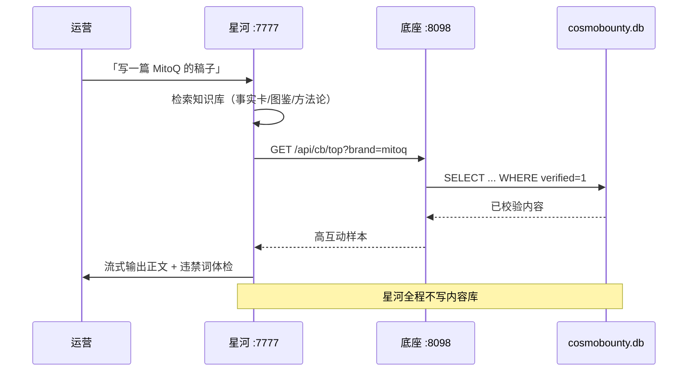

# 01 · 拓扑：三个产品怎么共用一个底座

## 一句话

三个前端，两个进程，一份数据。**谁都不许直接写内容库。**

## 物理布局

```
                    公网 :7777（唯一入口）
                            │
              ┌─────────────┴─────────────┐
              │   server.js  星河 StarRiver │  Node.js，零依赖
              │   ├─ /            星河主界面（SPA）
              │   ├─ /wb/         工作台静态（10 页）
              │   ├─ /niling/  ──┐ 反代
              │   ├─ /api/cb/* ──┤ 反代
              │   └─ /api/wb/* ──┤ 反代
              └───────────────────┼─────────
                                    │ 127.0.0.1:8098
                        ┌───────────┴──────────┐
                        │   app.py  底座        │  Python 标准库
                        │   ├─ /api/*   内容查询（18 个 GET + SQL）
                        │   ├─ /api/wb/* 工作台数据层（9 个）
                        │   ├─ /niling  逆龄观察浏览页
                        │   ├─ /cdn/*   七牛媒体同源代理
                        │   └─ MCP       13 个工具
                        └───────────┬──────────┘
                                    │ mode=ro
                        ┌───────────┴──────────┐
                        │  cosmobounty.db      │ 只读打开
                        │  8 张表 / 5996 条    │
                        └──────────────────────┘
```

## 为什么这么分

### 为什么底座和网关是两个进程

| 理由 | 具体后果 |
|---|---|
| 语言不同 | 星河是 Node 生态（SSE、流式），底座是 Python（SQLite、OCR 调用）。硬塞一起会互相拖累 |
| 数据性质不同 | 星河写业务数据（会话、积分、资产），底座只读内容。进程隔离让"误写内容库"物理上不可能 |
| 故障隔离 | 底座挂了工作台/逆龄观察 502，但星河还能用（读自己的 db.json）；反之亦然 |

底座的数据库连接是 `sqlite3.connect("file:...?mode=ro", uri=True)` —— **只读模式打开**。
这不是靠自觉，是 SQLite 层面的拒绝。

### 为什么三个前端不合并成一个

因为它们的使用者不是同一批人：

| 产品 | 使用者 | 打开频率 | 关注点 |
|---|---|---|---|
| 星河 | 内容运营 | 每天 | 「这篇稿子什么时候能发」 |
| 工作台 | 品牌方 / 操盘手 | 每周 | 「我这个月比竞品强在哪」 |
| 逆龄观察 | 选品 / 招商 / 外部 | 不定期 | 「最近有什么新东西」 |

强行合并的结果是每个人的首页都塞满别人关心的东西。分开做，各自首页只放自己最关心的。

但**数据必须是一份**。这条是踩过坑的：上一版三个前端各有一份数据快照，
同一个品牌在三个页面上出现三个不同的声量数字，被客户当场发现。

## 数据流向



## 目录 ↔ 部署位置

| 仓库路径 | 服务器路径 | 进程 |
|---|---|---|
| `starriver/` | `/data/apps/starriver/` | `starriver.service`（Node） |
| `base/` | `/data/apps/cosmobounty/` | `niling.service`（Python） |
| `base/crawler/` | 同底座目录 | cron 每日 08:30 |
| `workbench/`（本仓库） | `/data/apps/starriver/public/wb/` | 由星河网关静态托管 |

> 工作台前端物理上在星河目录下（因为由星河托管静态文件），
> 但它的数据全部来自底座。改工作台页面不用动底座，改数据口径不用动前端。

## 端口约定（写死，别抢）

| 端口 | 谁 | 说明 |
|---|---|---|
| `7777` | 星河网关 | 公网唯一入口 |
| `8098` | 底座 | **只绑 127.0.0.1**，不对外 |
| `7788` | 星河体验库 | 本地演示，`SB_DATA=data-demo` |
| `8080` | 别人的 nginx | **永远不要占**，占了就有人来找你 |

## 一次请求的完整路径

以工作台列表页为例：

```
浏览器 /wb/index.html
  → JS fetch('/api/wb/list.js?brand=mitoq')
    → 星河 server.js: isBasePath('/api/wb/list.js') → true
      → proxyBase() 转 127.0.0.1:8098/api/wb/list.js
        → app.py: p.startswith('/api/wb/') → _wb()
          → wbdata.list_rows('mitoq')
            → SQLite 只读查询 + 缓存（TTL 内直接返回）
          ← JSON
        ← 200
      ← 透传
    ← 200
```

**注意 `isBasePath` 在鉴权之前**。这是设计选择：底座的内容接口是公开的，
不走星河的登录态。代价是这些接口没有登录保护 —— 如果需要访问控制，
应该在网络层（VPN / 反向代理 basic auth）做，而不是在应用层加一层半吊子鉴权。
