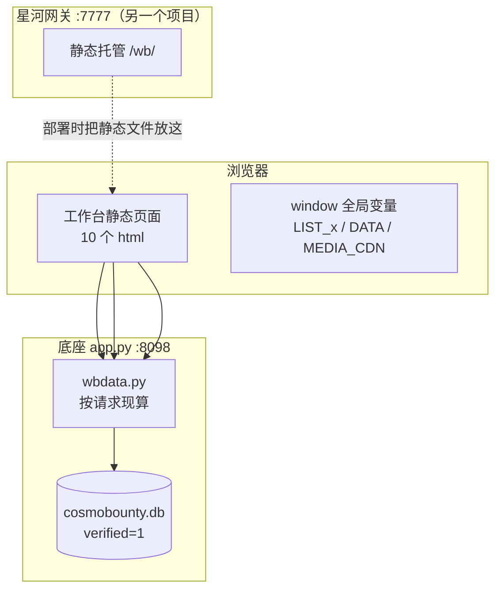
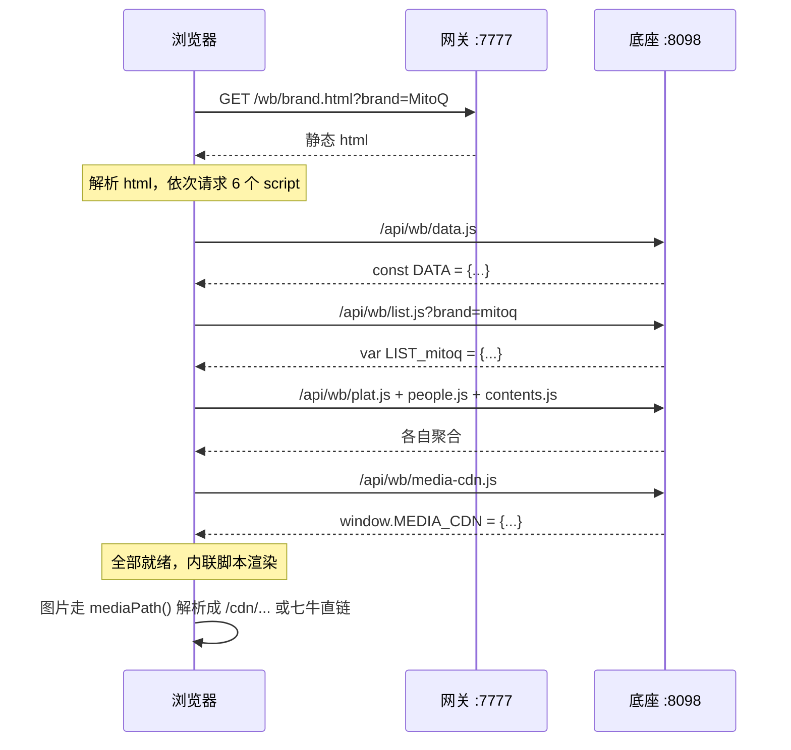
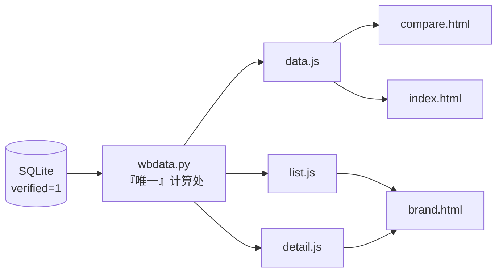

# 六品牌内容工作台 · 技术架构

> **这份文档的位置**：工作台是「同一套数据的另一个视角」—— 逆龄观察给外部人看"这个品牌怎么样"，工作台给操盘手看"我下一步该做什么"。
>
> 它和逆龄观察**共用同一个数据服务**（`app.py`），自己一行数据也不存。
> 相关：[底座架构](../ARCHITECTURE.md) · [口径说明](../docs/03-workbench.md) · [拓扑](../docs/01-topology.md)
>
> 代码基线：13 个文件 / 1666 行 / 652 KB（`products.js` 439 KB 是生成物，不算手写）。
> 数字取自 2026-10-29 的 `main` 分支。

---

## 目录

- [1. 定位与边界](#1-定位与边界)
- [2. 系统上下文](#2-系统上下文)
- [3. 运行时](#3-运行时)
- [4. 文件清单与职责](#4-文件清单与职责)
- [5. 数据契约](#5-数据契约)
- [6. 页面 × 数据依赖矩阵](#6-页面--数据依赖矩阵)
- [7. 关键链路](#7-关键链路)
- [8. 口径算在哪](#8-口径算在哪)
- [9. 缓存与版本控制](#9-缓存与版本控制)
- [10. 视觉层](#10-视觉层)
- [11. 失败模式](#11-失败模式)
- [12. 扩展点](#12-扩展点)
- [13. 技术债](#13-技术债)

---

## 1. 定位与边界

| 做什么 | 页面 |
|---|---|
| 六家同屏横评，指标口径写在页面上 | `compare.html` |
| 单品牌深度（平台分布 / 内容清单 / 达人结构） | `brand.html` |
| 逐条内容清单，按条件筛，点回原文 | `content.html` |
| 待核队列逐条判定 | `review.html` |
| 采集状态（哪个平台、哪一轮、卡在哪） | `collect.html` |
| 从数据里找角度写稿、写完登记 | `create.html` / `publish.html` |
| 手机端精简视图 | `mobile.html` |

| 明确不做 | 原因 |
|---|---|
| **不自己算指标** | 见 [8](#8-口径算在哪)。前端算 = 三个页面三个数字，这是踩过的坑 |
| 不存任何数据 | 没有 localStorage 业务状态，刷新即还原。数据只有一份，在底座 |
| 不做用户系统 | 谁能打开 `/wb/` 谁就能看。生产上由星河网关挡在前面 |
| 不引框架 | 无 React/Vue，无构建，无 node_modules |
| 不做实时推送 | 刷新即最新，没有 WebSocket/SSE |

---

## 2. 系统上下文



**关键点**：页面用 `<script src>` 而不是 `fetch`。原因是这样数据在页面脚本执行前就已就绪，不需要 async/await、不需要 loading 骨架、不需要处理竞态 —— 页面一渲染就有数据。

代价：首屏被阻塞在数据请求上。对 230 KB 的内网请求来说这个代价可以接受。

---

## 3. 运行时

### 3.1 零构建

没有 `package.json`、没有构建产物目录、没有 `npm run build`。`workbench/` 目录本身就是线上产物。

部署脚本做的事就是 `rsync workbench/ → 网关/public/wb/`。

### 3.2 唯一的生成物：`products.js`

```js
/* 由 crawler/fetch_product_catalog.py 生成，勿手改 */
var PRODUCTS = { "MitoQ": [ { name, desc, ingredients, notice, price, price_note, img, url, source } ], ... };
```

439 KB，是六家的产品目录（从官网抓的规格、成分、价格、注意事项）。

**为什么它可以是生成物而指标不行**：产品事实是"外部世界的客观信息"，抓下来存成静态文件没问题；指标是"对库的聚合计算"，必须每次现算。

文件头写着"勿手改" —— 手改会在下次抓取时被覆盖。

### 3.3 版本戳

所有本地资源都带 `?v=`：

```html
<script src="shared.js?v=20261028c"></script>
<script src="products.js?v=20261028c"></script>
```

网关对静态文件发的是 `Cache-Control: no-cache`，但浏览器仍可能用启发式缓存。带版本戳能确保"改了文件，用户一定拿到新的"。改完记得同步改版本号 —— 这是唯一需要人工记住的步骤。

---

## 4. 文件清单与职责

| 文件 | 行数 | 职责 |
|---|---|---|
| `index.html` | 144 | 六品牌总盘：声量、本周新增、异常提示 |
| `compare.html` | 141 | 跨品牌横评，六家同屏 |
| `brand.html` | 869 | **最重的页面**：单品牌全维度（平台 / 内容 / 达人 / 媒体 / 产品） |
| `content.html` | 433 | 内容清单：筛选、排序、分页、点回原文 |
| `create.html` | 339 | 创作中心：从数据里找角度 |
| `review.html` | 163 | 审核队列：待核内容逐条判定 |
| `collect.html` | 159 | 采集中心：平台状态、轮次、失败原因 |
| `publish.html` | 142 | 发布管理：写完登记 |
| `about.html` | 122 | 口径说明（**指标定义就写在这**） |
| `mobile.html` | 202 | 手机端精简视图 |
| `shared.js` | 165 | 品牌常量、平台属性、导航结构、公共组件 |
| `shared.css` | 240 | 主题变量、布局、组件样式 |
| `products.js` | 1（439 KB） | 产品目录（生成物） |

### 4.1 `shared.js` 里三个"唯一来源"

```js
// ① 六品牌：key 必须和数据库里的 brand 字段逐字一致（含中文品牌名）
const BRANDS = [
  { key: "MitoQ",  name: "MitoQ",  cn: "MitoQ",   color: "var(--b-MitoQ)" },
  { key: "塞乐瑞", name: "塞乐瑞", cn: "塞乐瑞",  color: "var(--b-塞乐瑞)" },   // ← 中文 key
  ...
];

// ② 平台属性：社媒看互动，媒体看收录
const PLAT_META = {
  xhs:   { kind: "社媒", metric: "互动" },
  baidu: { kind: "媒体", metric: "收录" },   // ← 百度 0 赞不是没效果，是媒体本来就没赞
};

// ③ 导航
const NAV_SECTIONS = [ { title: "总盘", items: [...] }, { title: "品牌", brandList: true }, ... ];
```

`key` 必须和库里 `brand` 字段**逐字一致**，包括中文。这是最容易出错的地方：大小写不同、全角半角不同，都会导致这个品牌的页面空着。

### 4.2 `EFF` 的一行教训

```js
/* 官号 vs 达人 效率：不再写死在代码里，直接取 data.js 里现算的 eff
   （写死过一次，结果数据库更新后页面三处数字打架——这条教训记在这） */
const EFF = (function () {
  const o = {};
  const bs = (typeof DATA !== 'undefined' && DATA.brands) || {};
  Object.keys(bs).forEach(k => { o[k] = bs[k].eff || { off_n: 0, ... }; });
  return o;
})();
```

注释保留在代码里，就是为了防止下一个人又把它写成常量。

---

## 5. 数据契约

工作台依赖 9 个端点，全部是 `<script src>` 引入的 JS（不是 JSON）。

| 端点 | 输出的全局变量 | 内容 |
|---|---|---|
| `/api/wb/data.js` | `const DATA` + `window.DATA` | 全局总览：品牌 × 平台矩阵、`eff` 官号/达人效率、日期 |
| `/api/wb/list.js?brand=<slug>` | `var LIST_<slug>` | 单品牌内容清单（含互动数、正文摘要、媒体引用） |
| `/api/wb/detail.js?brand=<slug>` | `var DETAIL_<slug>` | 单品牌深度数据 |
| `/api/wb/plat.js` | `const PLAT_DATA` | 平台维度聚合 |
| `/api/wb/people.js` | `const PEOPLE` | 达人结构（官号 / 达人 / 素人分布） |
| `/api/wb/contents.js` | `const contents` | 内容维度聚合 |
| `/api/wb/media-cdn.js` | `window.MEDIA_CDN` | 本地路径 → 七牛 URL 映射 |
| `/api/wb/media-index.js` | `const MEDIA_STAT` | 各品牌媒体/视频/正文统计 |
| `/api/wb/pending.js` | `const PENDING` | 待核队列 |

### 5.1 为什么是 JS 不是 JSON

历史原因，但保留它有实际好处：

| JS 输出 | JSON + fetch |
|---|---|
| 数据在脚本执行前就绪 | 要 await、要处理 loading 和竞态 |
| 页面代码不用改（从静态快照换过来时一行没动） | 每个页面都要改取数逻辑 |
| 可以直接 `?v=` 版本化 | 要另做缓存策略 |

**输出格式与旧静态文件逐字节兼容** —— 这是当年从"构建期烤快照"切到"按请求现算"时最关键的一条：`var LIST_mitoq = {...}` 和 `const DATA = {...}` 的变量名、结构、字段一个都没变。

### 5.2 slug 规则

`/api/wb/list.js?brand=` 的参数是 **slug**，不是品牌原名：

| 品牌 | slug |
|---|---|
| MitoQ | `mitoq` |
| LAIFE | `laife` |
| GRANVER | `granver` |
| 塞乐瑞 | `sailerui` |
| W+端粒塔 | `duanlita` |
| 科诗博缇 | `cosmobounty` |
| 品类场景词 | `category` |

底座对 slug 做白名单校验（`[a-z_]{2,20}`），不合法直接 400 —— 因为它要拼进 SQL 之外的路径逻辑。

---

## 6. 页面 × 数据依赖矩阵

| 页面 | data.js | list.js | detail.js | plat.js | people.js | contents.js | media-cdn.js | pending.js |
|---|:--:|:--:|:--:|:--:|:--:|:--:|:--:|:--:|
| `index.html` | ● | | | | | | ● | |
| `compare.html` | ● | | | | | | ● | |
| `brand.html` | ● | ● | | ● | ● | ● | ● | |
| `content.html` | ● | ● | ● | | | | ● | |
| `create.html` | ● | | | ● | ● | ● | ● | |
| `review.html` | ● | | | | | | ● | ● |
| `collect.html` | ● | | | | | | ● | |
| `publish.html` | ● | | | | | | ● | |
| `mobile.html` | ● | | | | | | ● | |
| `about.html` | ● | | | | | | ● | |

两个观察：

1. **`data.js` 和 `media-cdn.js` 全员依赖** —— 前者提供基础数据和导航用的品牌列表，后者提供媒体地址解析。少任何一个页面都白。
2. **只有 `brand.html` 依赖 6 个端点** —— 它是最重的页面（869 行），也是唯一做"全维度"的。改它要同时验证 6 个数据源。

---

## 7. 关键链路

### 7.1 打开一个品牌页



**6 个并行请求**，浏览器会并发发（HTTP/1.1 下默认 6 个连接，刚好）。内网延迟低，总体感知是"打开即出"。

### 7.2 媒体地址解析

```js
// 本地路径 "LAIFE/cover/xxx.jpg" → 实际可访问地址
mediaPath(rel) → MEDIA_CDN[rel] 或 拼成 cdn 域名
```

`MEDIA_CDN` 由底座实时算出来（`media_map()`），所以七牛换了域名/加了自定义域名，**只改底座，前端不用动**。

---

## 8. 口径算在哪

这是这份文档最重要的一节。



**所有指标都在 `wbdata.py` 里算，前端只做格式化。** 前端代码里没有一处 `sum()` / `avg()` 作用在业务数据上。

理由是一条真实事故：

> 早期指标算在前端。数据库更新后，同一个品牌的总赞数在总盘页、品牌页、横评页出现了三个不同数字 —— 因为三个页面各有一份自己的聚合逻辑，改了一个忘了另两个。
>
> 更糟的是「官号 vs 达人效率」被写成了常量，数据变了它不变，页面看起来完全正常。

现在的规则：

| 允许前端做 | 不允许前端做 |
|---|---|
| 数字格式化（万 / 亿、百分比保留几位） | 求和、求平均、求占比 |
| 排序、筛选、分页（基于已算好的字段） | 从原始行重新聚合 |
| 颜色映射（涨红跌绿） | 判定"这个品牌做得好不好" |

`about.html` 把口径定义**写在页面上**，因为看数字的人有权知道这个数怎么来的。

---

## 9. 缓存与版本控制

| 层 | 策略 |
|---|---|
| 底座数据 | 进程内 TTL：`data.js` 120s、`detail` 300s、`media` 600s |
| 页面静态文件 | 网关发 `Cache-Control: no-cache` |
| 本地资源（`shared.js` 等） | `?v=20261028c` 版本戳 |
| 图片/视频 | `/cdn/` 加 `max-age=86400` |

三层配合的结果：**改前端立刻生效**，改数据最多 2 分钟生效，媒体走 CDN 一天。

---

## 10. 视觉层

### 10.1 品牌色是 CSS 变量

```css
--b-MitoQ: ...;  --b-LAIFE: ...;  --b-塞乐瑞: ...;
```

变量名带中文品牌名，`shared.js` 里的 `color: "var(--b-塞乐瑞)"` 直接引用。**新增品牌必须同时加 CSS 变量和 JS 条项**，少一个就是无色块。

### 10.2 一个已经踩过的坑

`shared.css` 曾经有 27 处 `var()` **纯自引用**（`--sub: var(--sub)`），浏览器判为 invalid 且**不报错** —— 结果是灰色文字全部显示成白色、输入框没底色、主按钮没填充。

这类错误的特点：页面 200、控制台没红字、功能可用，只是"看着不太对"。修法是把真实值写死。

---

## 11. 失败模式

| 失败 | 表现 | 用户看到 |
|---|---|---|
| 底座没起 | 所有 `/api/wb/*` 404/502 | 页面骨架在，数字全 0 或空白；控制台有 `DATA is not defined` |
| `brand` 参数错 | `list.js` 返回 400 | 该品牌区域空 |
| 品牌 key 不匹配 | `DATA.brands['xxx']` 为 undefined | 该品牌卡片空（**最常见**） |
| 媒体映射缺失 | `MEDIA_CDN[rel]` 为空 | 图片裂开，但文字正常 |
| 七牛不可达 | `/cdn/` 502 | 图片裂开，页面可用 |
| 版本戳没改 | 浏览器用旧 JS | 明明改了代码看不到效果 |

**没有做全局错误兜底**：`DATA` 未定义时会直接抛错、页面渲染中断。这是取舍 —— 加兜底容易把"数据没来"伪装成"数据是 0"，而后者更危险（看起来一切正常）。

---

## 12. 扩展点

### 加一个页面

1. `shared.js` 的 `NAV_SECTIONS` 加 nav 项（`href` 指过去）
2. 按需引 `/api/wb/*`（对照 [依赖矩阵](#6-页面--数据依赖矩阵)）
3. 引 `shared.css` + `shared.js`
4. 把 `?v=` 版本号统一改掉

### 加一个指标

1. **在 `wbdata.py` 里算**，加到对应端点的输出里
2. 在 `about.html` 补口径定义
3. 前端只负责显示

不要在页面里写 `rows.reduce(...)` —— 这一条比什么都重要。

### 加一个品牌

三处必须同时改：

| 位置 | 改什么 |
|---|---|
| `shared.js` | `BRANDS` 加一项（`key` 必须与库中 `brand` 字段逐字一致） |
| `shared.css` | 加 `--b-<品牌>: <颜色>` |
| `config/brands.json`（底座仓库） | 品牌判定规则：别名、搜索词、竞品关系 |

少改任何一处，页面就会有一块是空的或没颜色的。

---

## 13. 技术债

| 债 | 现状 | 后果 | 何时必须还 |
|---|---|---|---|
| 数据用 `<script src>` 而非 fetch | 首屏阻塞在数据请求 | 网络差时白屏时间长 | 数据量再大就需要改异步 + 骨架屏 |
| 无全局错误兜底 | `DATA` 缺失直接抛错 | 页面渲染中断 | 如果要做成对外产品 |
| `brand.html` 869 行 | 单文件包含所有维度渲染 | 改动半径大，6 个数据源要同时验证 | 继续加维度 |
| 版本戳靠手工改 | `?v=20261028c` 人工同步 | 忘改 = 用户看到旧代码 | 至少改成部署脚本自动注入 |
| 品牌 key 中英混用 | `MitoQ` 和 `塞乐瑞` 都是 key | 拼写/全半角错就静默空页 | 加一个启动时校验（比对 BRANDS 与 DB 里的 brand 值） |
| `products.js` 439 KB | 全量内联，未按需加载 | 首屏多传 439 KB | 产品数继续增长 |
| 无自动化测试 | 靠人工看点 | 改完不知道有没有碰坏别处 | 至少给 `wbdata` 输出加快照测试 |
| 无 i18n | 中文硬编码 | 不能给海外客户 | 有需求再说 |

---

## 附：三个产品的关系

| 产品 | 在哪个仓库 | 在这套数据里的角色 |
|---|---|---|
| **六品牌内容工作台** | 本目录（`cosmo-platform/workbench/`） | 操盘手视角：横向对比 + 作业流 |
| **逆龄观察** | `cosmo-platform/app.py` | 外部视角：浏览 + 溯源 + 导出 |
| **星河 StarRiver** | `starriver` 仓库 | 无关（另一个项目），生产上给本工作台做静态宿主和网关 |

前两个是**一个项目的两个前端**：一套数据、同一套口径、同一份 `wbdata.py`。这也是为什么工作台不放自己的聚合逻辑 —— 一旦各算各的，两个前端就会给出两个答案。
